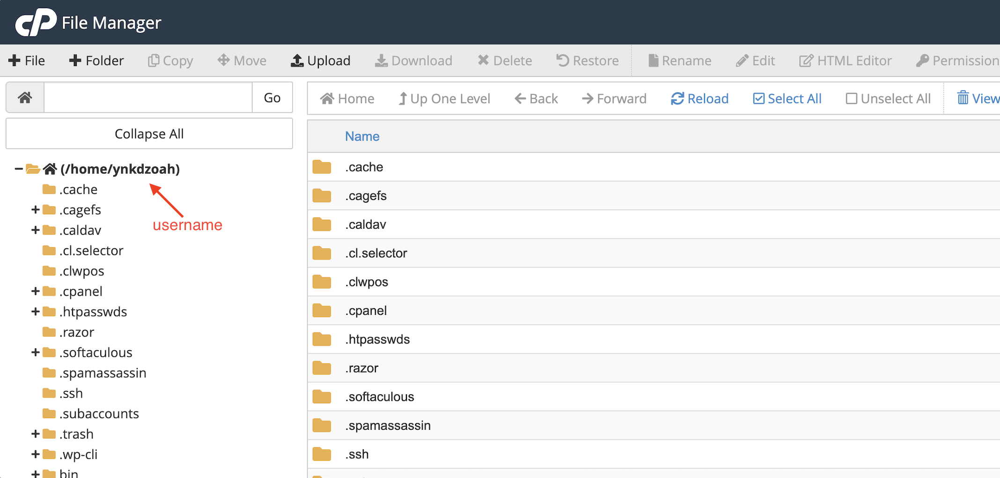
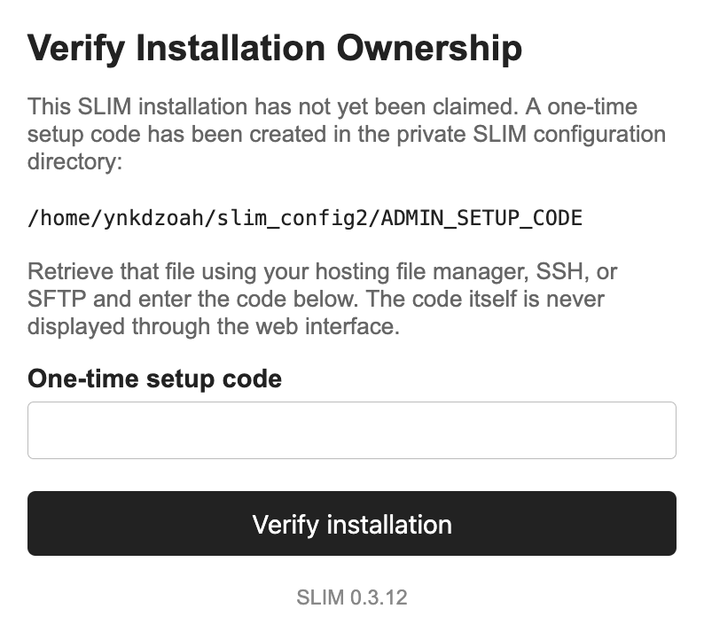
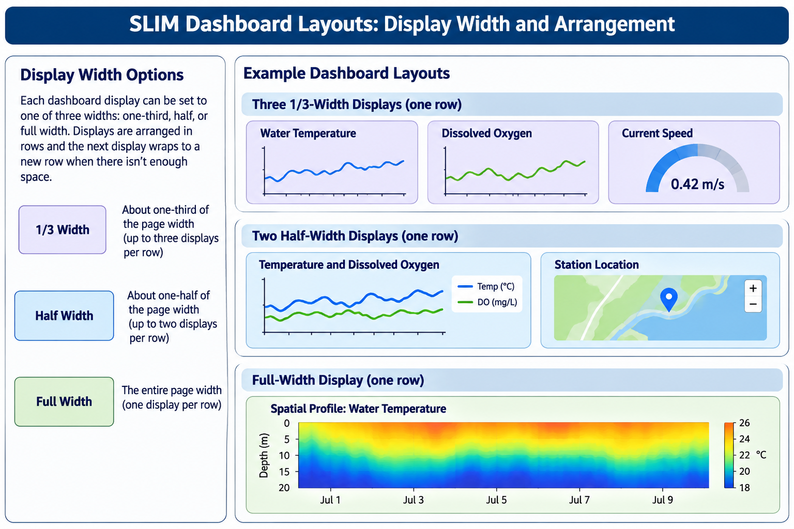

**SLIM (Share, Log, Ingest, Manage) Installation Manual**

Todd R. Miller

University of Wisconsin – Milwaukee

**\**
Installing SLIM

1.  SLIM needs to be installed on a webserver with access to PHP and
    MySQL. SLIM was generally built for a shared hosting service with
    access to cPanel, but can also be used on any equivalent system with
    stated requirements.

    See below (“SLIM Server Requirements”) for server requirements and
    recommendations on where to purchase relatively low-cost shared
    hosting services that have been tested with SLIM.

2.  To start the installation process, create two directories on your
    server using FTP or File Manager in cPanel.

First, create a directory in the publicly accessible directory of your
site (e.g. public_html) called “slim.” In this case, the SLIM
installation then will be accessed at

www.your-domain-name.com/slim

Alternatively, you can install SLIM directly into the public_html
directory without creating a sub-directory. In this case SLIM will be
accessible directly at your domain index

www.your-domain-name.com

Second, create a directory outside the publicly accessible directory on
your server, generally one level up from public_html. Name this
directory “slim_config” This directory will contain private
configuration settings for SLIM as well as backup files and backup
configuration settings. Note the path to this directory.

3.  Download the SLIM installation zip file from Github and unpack it.
    The latest version can be found at
    <https://github.com/trexmiller/slim>

4.  In a text editor such as notepad (Windows) or TextEdit (Mac) open
    the file named “EXTERNAL_CONFIG_PATH” which is located in the
    “config/” directory of the unzipped SLIM installation files.

    Change the file path listed in the file to the location of the
    “slim_config” directory you created. If the slim_config directory
    was created one level up from public_html then the path is most
    likely the same as the file path already listed in the file except
    that you will need to enter the correct username:

> /home/*username*/slim_config
>
> Replace “*username*” with your actual username. To be sure of the path
> and your username, you can use the File Manager in cPanel or an FTP
> program like FileZilla to see where slim_config is created. File
> Manager will also list the username.

5.  Now it’s time to put SLIM on your server. Move all SLIM files and
    folders within the unzipped directory into the “slim” directory you
    created on your server in the publicly accessible location.

6.  In a web browser go to the location of the slim installation, which
    will be at www.your-domain-name.com/slim or
    www.your-domain-name.com, depending on where you put the
    installation files.

You will be asked to enter a one-time setup code. This code can be found
in the private configuration directory you created (slim_config) outside
your site’s publicly accessible directory. It will be in a text file you
can open with a text editor and copy/paste the code. Enter/paste the
code into the web form and click on verify installation.

7.  The page will allow you to then setup a new administrative username
    and password to manage SLIM. You have now taken ownership of this
    SLIM installation.

8.  Using cPanel, setup a new MySQL database and database user. You will
    need the database name, username and password to finish setting up
    SLIM.

9.  Under the admin pages of SLIM click on “Setup.” On the Setup page
    enter the database name, username and password. The database name
    and username are often prefixed with the cPanel username and “\_”.

Leave MySQL Host as localhost and Port as 3306 unless you know they
should be different. Click test connection and save.

10. On the Setup page, change the system time zone and other settings as
    desired and click on save system defaults.

    **<u>Note</u>**, you must click on save system defaults at least
    once before you can start setting up new monitoring stations and
    dashboards. SLIM needs to know that these settings are confirmed
    before proceeding.

11. If webhooks are to be used, then on the main Administration page
    click on “Webhook Deliveries” and then click on the link “Configure
    and verify the webhook scheduler.” Follow the instructions to setup
    a single Cron job to schedule webhooks which will allow you to setup
    scheduled deliveries of data from your stations to other endpoints
    (i.e. other websites).

    If you have a shared hosting service with cPanel, then in cPanel go
    to Cron Jobs under Advanced. Under “Add New Cron Job” select “Once
    Per Minute(\*\*\*\*)” and in the Command box enter the example
    command from the Webhook Scheduler Setup page in SLIM.

    /usr/local/bin/php
    /home/ynkdzoah/public_html/slim/webhook/dispatch.php

    Change the /usr/local/bin/php to whatever is shown under the
    “general example” command shown under the Add New Cron Job page in
    cPanel. Also note that there should be no single quotes in the
    command.

    Click on Add New Cron Job.

12. SLIM is now configured. The first thing to do is setup your first
    monitoring station under “Create Station” at the Administration
    homepage.

## Create a New Station

1.  Click on “Create Station” on the Administration homepage

2.  On the next page, enter a station code, database name and station
    name. These are required and custom made by the administrator (i.e.
    you). However, there are some limitations as described below.

    Station Code:

    2–32 characters; letters, numbers, hyphens (-), and underscores (\_)
    only. Cannot contain spaces or periods. Case-insensitive because
    SLIM converts letters to uppercase. Must be unique among existing
    station configurations. This code is used in configuration filenames
    and station identification.

    MySQL Table Name:

    1–64 characters; must begin with a letter. Only letters, numbers,
    and underscores permitted. No hyphens or spaces. Must be unique,
    cannot already exist in the database. Case sensitivity can vary
    depending on the MySQL server configuration, so avoid names
    differing only by capitalization. Recommend using letters, numbers,
    and underscores, with a consistent naming convention.

    Station Name:

    Any nonempty text after trimming whitespace. Spaces, punctuation,
    and mixed case are permitted. Does not need to be unique. Can be
    changed later without changing the station code. This is displayed
    on dashboards and station listings.

    NOTE: We suggest making the station code the same as the MySQL table
    name and keep it as a 3 – 5 letter code or acronym that corresponds
    to the station name, possibly with a number appended as needed. For
    example, the fifth buoy deployed in Crystal Lake has the code “CRL5”
    and database name “CRL5” and station name “Crystal Lake Station 5.”

3.  Enter the GPS coordinates for the station location in decimal
    degrees. If you don’t know then get an approximate location from
    Google Earth. Currently these are required fields.

4.  Enter the time zone the station is located in. This can be different
    from the system time zone, but otherwise defaults to system time
    zone.

5.  Enter the name of the variables or “incoming fields” exactly as they
    will be sent to SLIM from your station. They must match exactly or
    data ingestion will fail. The display label and units can be
    anything and changed at anytime under Station Management.

    NOTE, administration sessions timeout after 12 hours of inactivity.
    It is a good idea to save data before entering a large amount of new
    data for incoming fields.

    Incoming field variables can also be added, altered, edited later
    under station management.

6.  Click on “Create Station and Table” button. Assuming no errors, SLIM
    is now ready to receive data from this station!

    NOTE: The API-Key is displayed at the bottom of the page only once
    after creating the station. **You will need to save this key** and
    add it to the JSON POST or GET string header information when
    sending data to the station. If you forget to record the key, you
    can regenerate the API-Key for any station under the Station Details
    administration page. You will also need to include the station code
    in your JSON formatted POST request (see below).

A POST command will have the header X-API-Key followed by the actual
key. The JSON formatted payload follows. The JSON payload should contain
the code of the station with identifier “station.” See below for an
example.

X-API-Key: XXXXXXXXXXXXXXXXXXXXXX

content-length: 164

content-type: application/json

{

"batprct": 14.65,

"batv": 3.71,

"epoch": 1793848752,

"heading": 267,

"lat": 43.5526,

"lon": -87.8078,

"phumid": 50.57,

"pitch": 3.12,

"ptemp": 25.11,

"roll": -15.28,

"station": "SLM"

}

> The SLIM API endpoint for all stations is your domain name and then
> the path to the “ingest” directory within the SLIM installation. For
> example:
>
> www.your-domain-name.com/slim/ingest/ (note: include the trailing
> forward slash)
>
> Additional information about configuring your device to send data to
> send data to specific SLIM station can be found by going to
> ***<u>Admin Home \> Station Directory and then scroll to the right to
> the “Actions” column and click on “API Setup”</u>***

## Create a Dashboard

1.  You might want to have SLIM create derived variables or unit
    transformations for you before creating a dashboard. For example if
    you want to display temperatures in Fahrenheit instead of Celsius.
    First go to Go to Variables and Fields under Station Manage and fill
    in the units for each variable and save. Then go to Derived
    Variables under Station Management. SLIM automatically recognizes
    some units and offers common unit translations. Click the box next
    to the suggested unit conversion for selected variables and click
    save. A new column of data in the new unit will be created for those
    variables and they will be available for plotting in a dashboard. If
    one is not automatically suggested then further down on the page you
    can create a derived variable doing simple mathematical expressions.

2.  Click on the Dashboard Creator on the Administrator homepage.

3.  Select the station you want to make a dashboard for in the dropdown
    box.

4.  Click the check boxes to choose to display the station code, GPS
    coordinates, date and time of latest data received and/or the local
    time as a live counter. The site name and monitoring station name
    are listed at the top of every dashboard by default and this cannot
    be changed in the Dashboard Creator, but these can be edited under
    Public Site Configuration and Station Management \> Station Details
    administrative pages.

5.  Under current displays, a date range selector is shown by default.
    This date range selector applies to time series plots only. If you
    do not want it then it can be deleted after adding other displays.

<figure>

<figcaption>
<u>Choose a display and configure it.</u> SLIM provides
nine types of dashboard displays for presenting environmental monitoring
data, station information, and other content. Administrators can combine
multiple displays to create dashboards suited to the instruments,
measurements, and monitoring objectives of individual
stations.
</figcaption>
</figure>

> Dashboard displays are arranged in rows from top to bottom in order
> chosen and each display is assigned a width of full, half or
> one-third. If full width is chosen, then that display occupies the
> entire row and therefore only one display is in that row. Similarly, a
> display with half width occupies half the row and another half width
> display can go into that row.

The order of displays by row and top to bottom can be changed at any
time by clicking the up or down arrow on the configured display. Choose
a display in the dropdown box and configure it.

## Display Types

### Time-Series Line Plot

The Time-Series Line Plot displays changes in one or more measured
variables over time. Measurements are plotted against their observation
timestamps, allowing users to examine temporal trends, fluctuations, and
relationships among variables.

Multiple variables can be included in a single plot, with configurable
line colors, styles, widths, and point markers. A secondary vertical
axis is available for displaying variables with different units or
measurement ranges. Additional options include axis labels, value
limits, legends, and data smoothing through a rolling average.

Example applications: Displaying water temperature over several days

### Recent-Value Gauge

The Recent-Value Gauge provides a compact visual representation of a
single measured variable. It is intended for quickly assessing the
current or most recently reported environmental condition without
examining a complete time series.

The gauge can display the latest observation or an average of a
user-defined number of recent observations. Administrators can configure
the displayed units, decimal precision, minimum and maximum values, and
colors. Four presentation styles are available: circular ring,
semicircular gauge, horizontal bar, and numeric display.

Example applications: Displaying the most recent water temperature,
dissolved oxygen concentration, battery voltage, or wind speed.

### Polar Plot (Wind Rose)

The Polar Plot displays the distribution of measurements that contain
both a direction and a magnitude. Observations are grouped into
directional sectors, allowing users to identify prevailing directions
and patterns in the associated measurement magnitude.

Administrators select the direction and magnitude variables, the number
of recent observations to include, and the magnitude intervals used to
organize the plot.

Example applications: Displaying wind direction and speed distributions,
identifying prevailing wind conditions, or examining directional
water-current measurements.

### Recent Directional Observations

The Recent Directional Observations display presents a sequence of
recent measurements containing both direction and magnitude. Unlike the
Polar Plot, which summarizes a distribution, this display emphasizes
individual observations and their directional variability. This is a
good plot for showing how directional observations have been changing
recently.

Administrators select the direction and magnitude variables, specify how
many recent observations to include, and provide the appropriate
magnitude units.

Example applications: Monitoring recent changes in wind direction,
observing shifts in current direction, or examining rapidly changing
directional conditions during a storm.

### Spatial Profile Plot

The Spatial Profile Plot displays measurements according to their
positions along a spatial coordinate rather than time. Multiple
variables or sensor measurements are assigned numerical positions
corresponding to depth, height, distance, or another spatial dimension.

Administrators specify the measurement fields and their associated
positions, along with the coordinate label and units. The display can
use the latest observation or averages of multiple recent observations.
Configurable color-scale limits are also available.

Example applications: Displaying a vertical water-temperature profile
from a chain of thermistors, soil moisture or temperature by depth,
change in temperature with height above ground on a monitoring tower.

### Station Location Map

The Station Location Map provides an interactive geographic map showing
the location of a monitoring station. It uses Leaflet mapping technology
and allows users to explore the surrounding geographic area.

Two location modes are supported. Static mode displays the latitude and
longitude entered during station setup. Live mode uses latitude and
longitude variables received through the station's data-ingestion
system, allowing the displayed location to reflect the latest reported
coordinates. A fallback to the static station coordinates can be
configured if for some reason the latest ingested coordinates are zero
or NULL. The map automatically indicates if the position displayed is
from static or live coordinates.

Administrators can also specify the initial map zoom level and display
height.

Example applications: Showing the location of a fixed water-quality
monitoring buoy, identifying a stream monitoring site, or displaying the
latest reported position of a mobile monitoring platform.

### Image Display

The Image Display allows administrators to upload and present an image
within a station dashboard. Images provide visual context that may not
be apparent from numerical measurements alone.

Supported image formats include JPEG, PNG, and WebP, with a maximum
upload size of 5 MB. Administrators can add an optional caption and
alternative text describing the image.

Example applications: Displaying a photograph of a monitoring station,
showing the configuration of installed instruments, presenting a
sampling-site photograph, or providing a diagram of the monitoring
system.

### Custom Text Display

The Custom Text Display allows administrators to add explanatory
information directly to a dashboard. It can contain a heading, body
text, or both, and supports permitted formatted content.

This display is useful for providing context, instructions,
descriptions, or other information that does not originate from a sensor
measurement.

Example applications: Describing the purpose of a monitoring station,
explaining sensor measurements, providing data-use qualifications,
acknowledging project funding, or displaying contact information.

### Date Range Selector

> The Date Range Selector allows users to specify the period of
> observations displayed in a dashboard's Time-Series Line Plots. Users
> enter a starting date (*From*) and ending date (*To*), then select
> *Show Date Range* to update the plots.
>
> The selected dates are interpreted using the monitoring station's
> configured local time zone.
>
> The selected range applies to all Time-Series Line Plots on the
> dashboard. Other display types, such as gauges, polar plots, and
> spatial profiles, are not controlled by the Date Range Selector.
>
> **Default Time Period**
>
> When a dashboard is first opened, Time-Series Line Plots display a
> default period of recent observations. The default is **72 hours (3
> days)**.
>
> Administrators can change this setting under:
>
> **Administration → System Setup → Default graph period (hours)**
>
> Selecting *Reset to latest \[number\] hours* in the Date Range
> Selector returns the dashboard to its default time period.
>
> **Public Dashboard Date Range Limits**
>
> To prevent excessive database queries and browser rendering demands,
> SLIM limits the maximum date range that visitors can request on public
> dashboards.
>
> The default maximum is **30 calendar days**, although administrators
> can increase this limit to as much as **3,650 days (approximately 10
> years)**.
>
> This setting is located under:
>
> **Administration → Site Configuration → Maximum public date range
> (days)**
>
> If a visitor requests a period longer than the configured maximum,
> SLIM displays an error indicating the permitted range.
>
> **Maximum Number of Plotted Observations**
>
> SLIM also limits the number of observations displayed in each public
> Time-Series Line Plot.
>
> The default limit is **5,000 plotted observations per plot**,
> configurable from 100 to 20,000.
>
> This setting is located under:
>
> **Administration → Site Configuration → Maximum points per public
> time-series plot**
>
> If the requested date range contains more observations than the
> configured limit, SLIM automatically selects a representative
> distribution of the original observations across the requested period.
>
> This process is called *systematic downsampling*. SLIM selects actual
> recorded measurements rather than calculating averages or aggregating
> observations into time intervals.
>
> Downsampling affects only the displayed plot. It does not modify or
> delete measurements in the database, and the original observations
> remain available for other uses, including data export.

6.  Once the dashboard is finished it needs to be published. By default,
    all new dashboards are not publicly available. To publish the
    dashboard go to the Station Details page from the Administration
    home page. Choose the station you want to publish from the dropdown
    box at the top of the page and then scroll down to check the
    “Publish station” box. Click on Save Station
    Details.

## 

## SLIM Server Requirements

SLIM is designed to operate on conventional web-server infrastructure
and does not require a dedicated server, containerization, or commercial
cloud IoT platform.

The application requires:

- A web server capable of executing PHP 8.1 or newer (PHP 8.2 or 8.3
  recommended).

- A MySQL-compatible relational database supporting InnoDB tables.

- PHP extensions for PDO MySQL, cURL, JSON, sessions, and file
  information handling. The ZIP extension is required for applicable
  export functions.

- HTTPS access and a writable, protected application configuration
  directory.

- Database permissions sufficient to create, modify, and delete tables
  and indexes.

- For outbound webhook delivery, SLIM additionally requires PHP
  command-line execution and a scheduled cron task.

Most shared Linux hosting services provide these requirements.

Server resource requirements depend on the number of monitoring
stations, observation frequency, data retention, and webhook activity.
Organizations should provision database storage according to their
expected observation volume. For example, providers like Godaddy and
Hosting.com typically provide 1GB to 5GB of data per database and allow
multiple databases with lower cost plans. SLIM only needs one database.
Users can purchase additional storage if needed. A typical observing
station generates about 50 to 100 MB of data. Thus, a single database on
a shared hosting service should allow dozens of monitoring stations per
year.

Unless you are self – hosting, then purchase a shared hosting service
with access to cPanel.

**Shared Hosting Providers**

SLIM is designed to operate on conventional web hosting infrastructure
supporting PHP and MySQL-compatible databases. A dedicated server,
virtual private server (VPS), or commercial cloud IoT platform is not
required for typical installations.

**Tested Hosting Providers**

SLIM has been successfully installed and tested on the following
commercial shared hosting services:

- hosting.com (formerly A2 Hosting): <https://hosting.com>

- GoDaddy: <https://www.godaddy.com>

**Other Potential Hosting Providers (Not Tested)**

Numerous other commercial shared hosting services may support SLIM,
including Hostinger, Bluehost, SiteGround, DreamHost, InMotion Hosting,
Namecheap, GreenGeeks, HostGator, IONOS, HostPapa, ScalaHosting,
HostArmada, FastComet, InterServer, ChemiCloud, KnownHost, and
Hostwinds.

These providers have not been evaluated for SLIM compatibility. Their
inclusion does not constitute an endorsement or guarantee of
compatibility.

Before purchasing hosting services, users should verify that their
selected hosting plan meets the SLIM Server Requirements, including
supported PHP versions and extensions, MySQL or MariaDB access, HTTPS,
appropriate filesystem permissions, and scheduled task support if
outbound webhook delivery is required.

SLIM may also be deployed on institutional or privately managed Linux
web servers meeting the same requirements.

Purchasing a shared hosting plan comes with a randomly generated domain
name. After purchasing your plan, login to cPanel to view this generated
domain name. You can choose to purchase a domain name of your choosing
later.

Explore cPanel, especially File Manager and “Manage My Databases” under
“Databases.” The SLIM installation requires creating new directories,
databases, database users and FTP users if you want to use FTP for the
installation.
